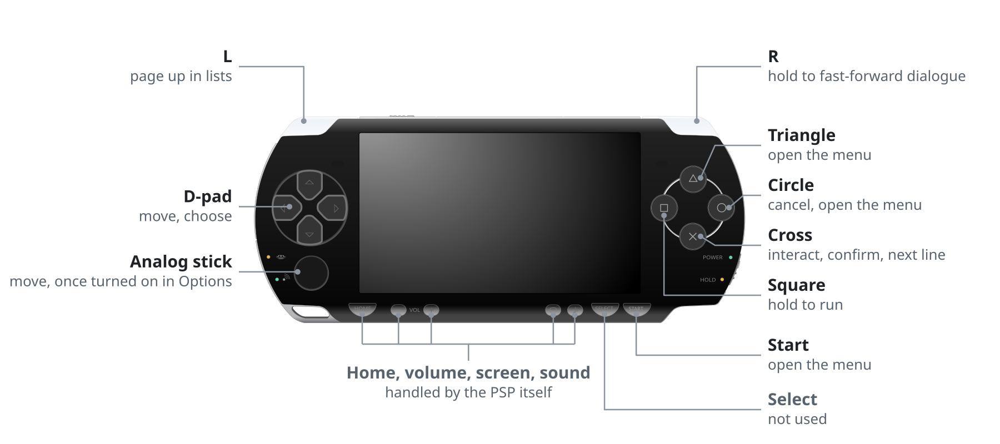
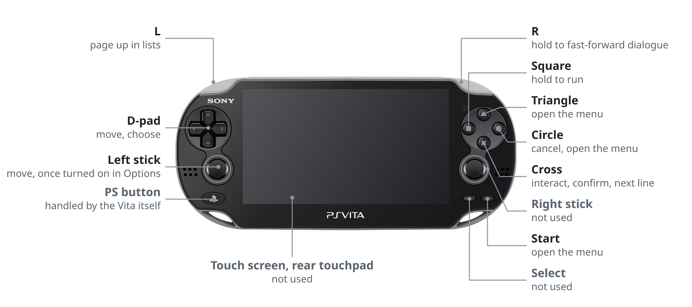
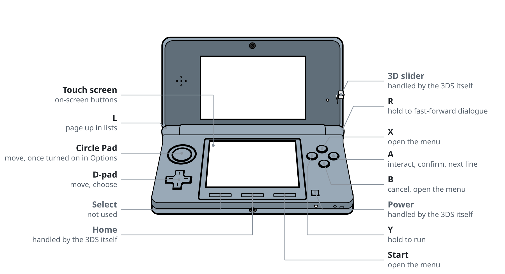
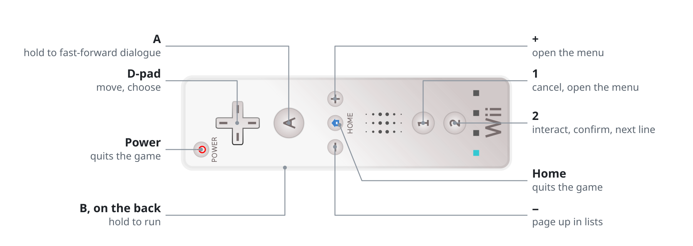
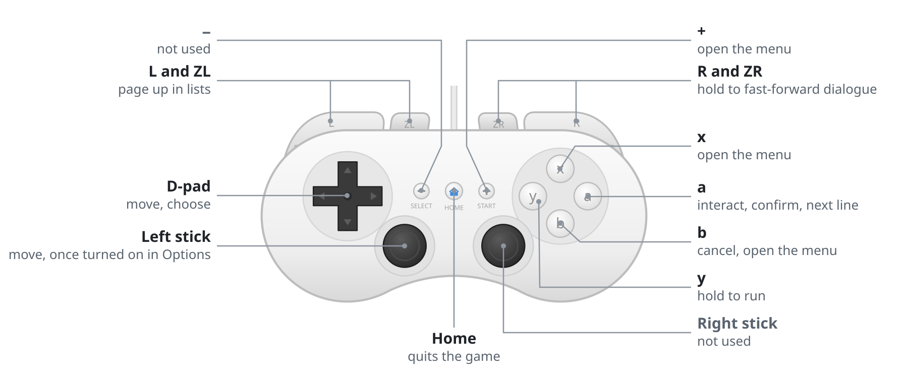
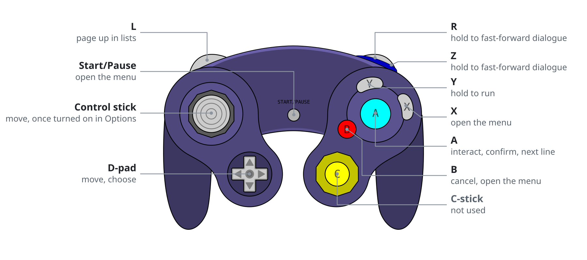
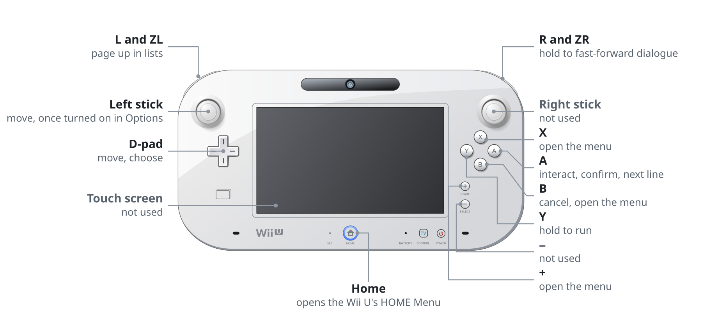
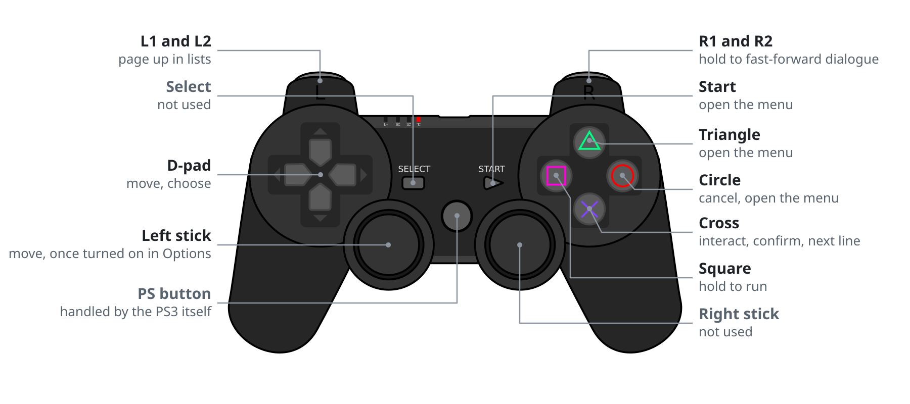
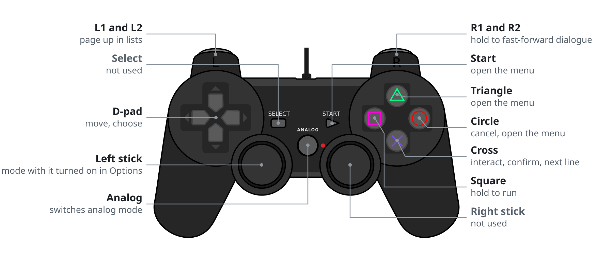
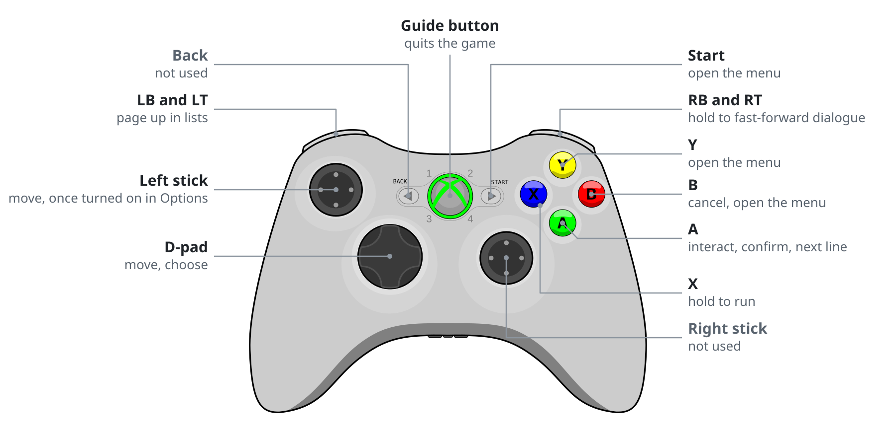

<h1 align="center">The Coffin of Andy and Leyley on your consoles</h1>

<p align="center">An unofficial fan port with an engine written from scratch, for the PSP, PS Vita, 3DS, Wii, Wii U, PS3, PS2 and Xbox 360. Bring your own copy of the game and the builder turns it into a game for the console you pick.</p>

<p align="center"><a href="https://tcoaal.ox80.cc"><b>Build it in your browser at tcoaal.ox80.cc</b></a></p>

<p align="center">Updates on Telegram: <a href="https://t.me/kotwisia">t.me/kotwisia</a> &nbsp;&nbsp;|&nbsp;&nbsp; Suggestions: <a href="https://github.com/meetox80/tcoaal/discussions/categories/suggestions">GitHub Discussions</a></p>

<p align="center">
  <a href="#get-started"><b>Get started</b></a> &nbsp;&nbsp;|&nbsp;&nbsp;
  <a href="#consoles"><b>Consoles</b></a> &nbsp;&nbsp;|&nbsp;&nbsp;
  <a href="#controls"><b>Controls</b></a> &nbsp;&nbsp;|&nbsp;&nbsp;
  <a href="#whats-different-from-pc"><b>What's different</b></a> &nbsp;&nbsp;|&nbsp;&nbsp;
  <a href="#building-from-source"><b>Building from source</b></a>
</p>

<br>

> [!IMPORTANT]
> There is no game content in this repository. Every image, sound and line of dialogue comes from your own copy,
> so the port does nothing without it. [Buy The Coffin of Andy and Leyley on Steam](https://store.steampowered.com/app/2378900/).

## Get started

**You need** The Coffin of Andy and Leyley 3.0.12 from Steam and one of the consoles below (or its emulator).

1. Open [tcoaal.ox80.cc](https://tcoaal.ox80.cc), or download the desktop builder from Releases.
2. Pick your console.
3. Give it your game folder (or a .zip of it), the one with `Game.exe` and `www` in it. On Steam, right-click the
   game, then Manage, then Browse local files.
4. Wait for the build, then follow the steps for your console below.

## Consoles

| Console | What you get | What you need | Install |
|---|---|---|---|
| PSP | `EBOOT.PBP`, about 155 MB | Any PSP with custom firmware, or PPSSPP | Copy the `PSP` folder to the root of the memory stick |
| PS Vita | `TCOAAL.vpk` and a `data` folder, about 355 MB | PS Vita or PS TV with HENkaku or Ensō and VitaShell, or Vita3K | Copy `data` to `ux0:`, install the vpk with VitaShell |
| 3DS | `tcoaal.3dsx`, about 130 MB, and optionally `tcoaal.cia` | Any 3DS or 2DS with custom firmware, the Homebrew Launcher and `sdmc:/3ds/dspfirm.cdc` for sound, or Azahar | Copy the `3ds` folder to the root of the SD card, or install the CIA with FBI |
| Wii | An `apps/tcoaal` folder, about 240 MB | Wii, or Wii U in Wii mode, with the Homebrew Channel, or Dolphin | Copy the `apps` folder to a FAT32 SD card or USB drive |
| Wii U | `tcoaal.wuhb` and `tcoaal.pak` in a `wiiu/apps/tcoaal` folder, about 480 MB | Wii U with Aroma, or Cemu | Copy the `wiiu` folder to the SD card; the game shows up on the Wii U Menu |
| PS3 | `TCOAAL.pkg`, about 480 MB | PS3 with PS3HEN or custom firmware, or RPCS3 | Package Manager, Install Package Files, from a USB drive |
| PS2 | `TCOAAL.iso`, about 160 MB | A PS2 that runs homebrew (FreeMcBoot, PS2BBL, a modchip or similar) with Open PS2 Loader, or PCSX2 | Put the iso in OPL's `DVD` folder |
| Xbox 360 | `xenon.elf` and a `tcoaal` folder, about 480 MB | Xbox 360 with RGH or JTAG and XeLL, or with the [Peer Pressure](https://github.com/grimdoomer/Xbox360PeerPressure) softmod and its XeLL extra | Copy both to the root of a FAT32 USB drive and boot XeLL (with Peer Pressure, power on with the eject button) |

Saves stay on the console when you update: in a `saves` folder next to the game on the PSP, Vita, 3DS, Wii, Wii U
and Xbox 360 (the 3DS `.3dsx` and CIA share theirs), in `/dev_hdd0/game/TCOAAL001/USRDIR/saves` on the PS3, and in a
`TCOAAL` folder on the memory card in slot 1 (or slot 2) on the PS2.

> [!NOTE]
> The PSP-1000 has half the memory of later models, so on it the game keeps its images in 16-bit color, holds fewer
> of them at once and loads more often. PPSSPP emulates a PSP-2000 unless you set the PSP model to PSP-1000 in its
> system settings.

<details>
<summary><b>More about the browser builder</b></summary>
<br>

The builder runs at [tcoaal.ox80.cc](https://tcoaal.ox80.cc). Pick a console, drop in your game folder or a .zip of it,
press Build and download the result. To run the page yourself, `make web-serve` builds it and serves it on
http://localhost:8080.

Everything happens inside your browser and nothing is uploaded. The page needs a current Chrome, Edge, Firefox or
Safari and free disk space for a copy of the game plus the result, because the browser keeps both in its own storage.

The page ships none of the game's files either. Once it has your copy, it dresses itself up with the title art, the
game's dialogue box and choice buttons, its font and sounds, and Andrew and Ashley's own lines of dialogue, all read
from that copy inside your browser. There are a few things to find on it.

</details>

<details>
<summary><b>More about the desktop builder</b></summary>
<br>

One executable holds every console. Run it without arguments, or double-click it: it looks for the game in your
Steam library, asks for the folder if it can't find it, asks which console to build for and where to save, and shows
its progress while it works. From a terminal:

```
tcoaal-builder path/to/game -o out --target vita
```

`--target` takes `psp` (the default), `vita`, `3ds`, `wii`, `wiiu`, `ps3`, `ps2` or `xbox360`. `--cia` also writes the
3DS CIA, `--voices DIR` adds voice clips for the dialogue, and `--update-engine` swaps in a newer engine without
converting the game again. `tcoaal-builder --help` lists every option. The builder refuses game versions other than
3.0.12 and warns when a copy looks cracked.

</details>

## Controls

The buttons follow the game's own gamepad layout. Options has a few console settings: **Confirm Button** swaps Cross
and Circle on the PlayStation consoles, **Analog Stick** (or Circle Pad, Control Stick, Left Stick) lets the stick
move you as well as the D-pad, and **Text Size** makes the dialogue, names and choices 1.5 times bigger.

<details>
<summary><b>PSP</b></summary>
<br>

<p align="center">
  <picture>
    <source media="(prefers-color-scheme: dark)" srcset=".github/controls/psp-light.svg">
    
  </picture>
</p>

</details>

<details>
<summary><b>PS Vita</b></summary>
<br>

<p align="center">
  <picture>
    <source media="(prefers-color-scheme: dark)" srcset=".github/controls/vita-light.svg">
    
  </picture>
</p>

</details>

<details>
<summary><b>3DS</b></summary>
<br>

<p align="center">
  <picture>
    <source media="(prefers-color-scheme: dark)" srcset=".github/controls/3ds-light.svg">
    
  </picture>
</p>

</details>

<details>
<summary><b>Wii, Wii Remote held sideways</b></summary>
<br>

<p align="center">
  <picture>
    <source media="(prefers-color-scheme: dark)" srcset=".github/controls/wii-remote-light.svg">
    
  </picture>
</p>

</details>

<details>
<summary><b>Wii, Classic Controller</b></summary>
<br>

<p align="center">
  <picture>
    <source media="(prefers-color-scheme: dark)" srcset=".github/controls/wii-classic-light.svg">
    
  </picture>
</p>

</details>

<details>
<summary><b>Wii, GameCube controller</b></summary>
<br>

<p align="center">
  <picture>
    <source media="(prefers-color-scheme: dark)" srcset=".github/controls/gamecube-light.svg">
    
  </picture>
</p>

</details>

<details>
<summary><b>Wii U GamePad</b></summary>
<br>

<p align="center">
  <picture>
    <source media="(prefers-color-scheme: dark)" srcset=".github/controls/wiiu-gamepad-light.svg">
    
  </picture>
</p>

</details>

<details>
<summary><b>PS3</b></summary>
<br>

<p align="center">
  <picture>
    <source media="(prefers-color-scheme: dark)" srcset=".github/controls/ps3-light.svg">
    
  </picture>
</p>

</details>

<details>
<summary><b>PS2</b></summary>
<br>

<p align="center">
  <picture>
    <source media="(prefers-color-scheme: dark)" srcset=".github/controls/ps2-light.svg">
    
  </picture>
</p>

</details>

<details>
<summary><b>Xbox 360</b></summary>
<br>

<p align="center">
  <picture>
    <source media="(prefers-color-scheme: dark)" srcset=".github/controls/xbox360-light.svg">
    
  </picture>
</p>

</details>

| Action | PSP, Vita, PS3, PS2 | Xbox 360 | 3DS | Wii U GamePad, Pro Controller | Wii Remote (sideways) | Classic or GameCube controller |
|---|---|---|---|---|---|---|
| Move | D-pad, or the left stick once turned on | D-pad, or the left stick once turned on | D-pad, or the Circle Pad once turned on | D-pad, or the left stick once turned on | D-pad | D-pad, or the stick once turned on |
| Interact, confirm, next line | Cross | A | A | A | 2 | A |
| Cancel | Circle | B | B | B | 1 | B |
| Menu | Triangle or Start | Y or Start | X or Start | X or + | + | X, + or Start |
| Run (hold) | Square | X | Y | Y | B | Y |
| Fast-forward dialogue (hold) | R (R1 or R2 on the PS3 and PS2) | RB or RT | R | R or ZR | A | R, ZR or Z |
| Page up in lists | L (L1 or L2 on the PS3 and PS2) | LB or LT | L | L or ZL | − | L or ZL |

## What's different from PC

- **No keyboard or mouse options.** Fullscreen, window size and key settings are gone; Options has the console
  settings above instead.
- **Picture size follows the console.** The Wii U, PS3 and Xbox 360 keep the full 1280x720 artwork. The Vita draws
  the game at 960x544, the Wii at 640x360, the PSP at 480x272, the PS2 at 480x272 scaled to the TV picture and the
  3DS at 400x225 on the top screen, with the artwork scaled down to match.
- **The 3DS bottom screen has buttons** for running, fast-forward, the menu, saving and advancing text.

## Where it's at

| | PSP | Vita | 3DS | Wii | Wii U | PS3 | PS2 | Xbox 360 |
|---|---|---|---|---|---|---|---|---|
| Builds | Yes | Yes | Yes | Yes | Yes | Yes | Yes | Yes |
| Plays in an emulator | PPSSPP | Untested | Azahar | Dolphin | Untested | RPCS3 | PCSX2 | Untested |
| Real hardware | Runs | Runs | Runs | Untested | Runs | Untested | Runs | Untested |

Every map loads on the desktop build, which runs the same engine and data, and `make test-psp1000` plays scripted
scenes and every map in PPSSPP as a PSP-1000 and checks that every image loads.

## Under the hood

| Folder | What's in it |
|---|---|
| `engine/` | A C++ port of the RPG Maker MV runtime (maps, events, interpreter, pictures, screen effects) and of the plugins and custom systems the game uses. One renderer per console under `engine/src/platform/`: GU on the PSP, GXM on the Vita, citro3d on the 3DS, GX on the Wii, GX2 on the Wii U, RSX on the PS3, the GS on the PS2 and Xenos on the Xbox 360, plus SDL2 with a software renderer for testing on the desktop. Each console has a `profile.h` with its screen size, texture layout and memory budget. |
| `tools/builder/` | Decrypts your game files, scales and stores the artwork in the layout each console's GPU reads directly, packs maps, events and dialogue, renders the game font, draws the controls picture for that console's buttons, makes the icons, menu art and menu music, and writes the console's own package next to the prebuilt engine. |
| `web/` | The same builder compiled to WebAssembly, with a page around it. |

## Building from source

You need `make`, `cmake`, a C and C++ compiler and `curl`. Each console's toolchain, and zig (for `make release` and
`make web`), are downloaded into `_deps/` the first time you build for it. The PS3 one also needs the development files
for libelf, GMP, OpenSSL and zlib, and the Xbox 360 one is built from source. makerom and bannertool (for the 3DS CIA)
are built from source into `_deps/ctrtools`.

```
make engines          # build every console engine (downloads the toolchains the first time)
make psp              # or vita, 3ds, wii, wiiu, ps3, ps2, xbox360: build one engine
make builder          # build the builder for this machine (embeds every engine)
make run              # run the builder (GAME=path/to/game, OUT=folder and TARGET=console are optional)
make test             # run the builder unit tests
make test-psp1000     # play scripted scenes of a built EBOOT in PPSSPP as a PSP-1000 (needs PPSSPPSDL)
make desktop          # desktop test build (needs SDL2, libvorbis, zlib); TARGET picks the console layout, make play runs it
make web              # build the in-browser builder into build/web; make web-serve serves it on localhost:8080
make release          # cross-compile the builder for Linux, Windows (x64 and ARM) and macOS
make help             # every target
```

Plain `make` builds every engine and the builder. The Vita, Wii U and Xbox 360 shaders are checked in; `make vita-shaders`,
`make wiiu-shaders` and `make xbox360-shaders` rebuild them.

## License

All rights reserved; this is not open source. You may build and run it for your own personal use, but you may not
modify, redistribute or publish it or builds of it. That's only so the port can't be used to pirate the game or to
pass around malware under its name: every release comes from here. [LICENSE](LICENSE) has the details and lists the
third-party parts with their own licenses: miniz and fflate (MIT), stb (MIT or public domain), the Tremor Vorbis
decoder (BSD) and the RPG Maker MV corescript (MIT).

The Coffin of Andy and Leyley and everything in it (characters, artwork, music, sounds, fonts and writing) is
&copy; Kit9 Studio and Nemlei, all rights reserved, and so is the artwork at the top of this page, which is loaded from
the game's Steam page. This project is not affiliated with or endorsed by them. Most
console drawings in the controls diagrams come from Openclipart and are in the public domain (CC0): the
[PSP-2000 by Todd Partridge](https://openclipart.org/detail/171228/psp-2000-black), the
[3DS by BHSPitMonkey](https://openclipart.org/detail/158047/handheld-3d-game-system), the
[Wii Remote by lexaficus](https://openclipart.org/detail/96367/wiimote), and the
[PS3](https://openclipart.org/detail/25145/playstation3-gamepad), [GameCube](https://openclipart.org/detail/25144/gamecube-gamepad)
and [Xbox 360](https://commons.wikimedia.org/wiki/File:Xbox360_gamepad.svg) controllers by Grumbel, with the PS2
controller adapted from that PS3 drawing. The [PS Vita](https://commons.wikimedia.org/wiki/File:PlayStation_Vita_illustration.svg)
and [Wii U GamePad](https://commons.wikimedia.org/wiki/File:Wii_U_controller_illustration.svg) drawings are by Tokyoship on
Wikimedia Commons under [CC BY 3.0](https://creativecommons.org/licenses/by/3.0/), with the Vita recolored white for the dark theme.

<br>

<p align="center"><sub>made by <a href="https://github.com/meetox80">kotwicha</a></sub></p>
